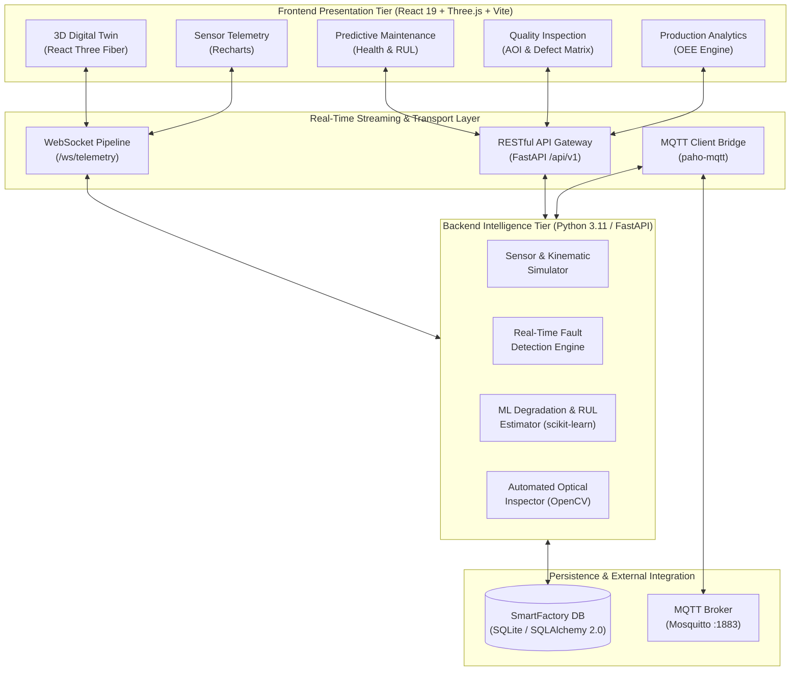
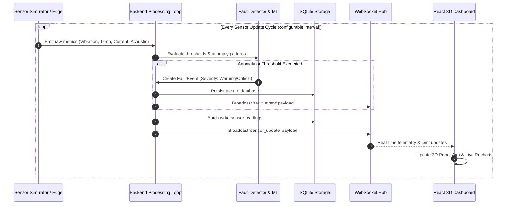
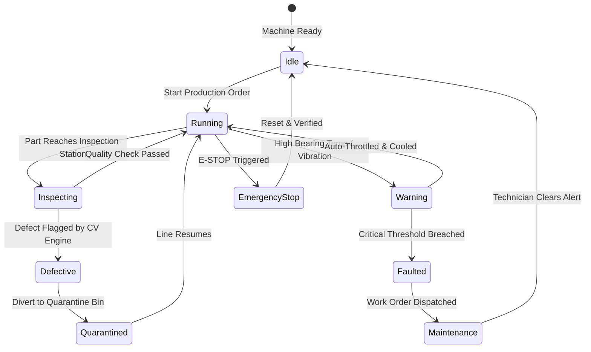

# 🏭 SmartFactory 4.0 — Next-Gen Industry 4.0 & Digital Twin Platform

<div align="center">

[](https://fastapi.tiangolo.com/)
[](https://react.dev/)
[](https://threejs.org/)
[](https://vitejs.dev/)
[](https://python.org)
[](https://websockets.readthedocs.io/)
[](https://mqtt.org/)
[](https://opencv.org/)
[](https://scikit-learn.org/)
[](LICENSE)

<br/>

**A state-of-the-art Cyber-Physical Production System (CPPS) combining WebGL 3D Digital Twin visualization, live IIoT sensor telemetry, machine learning predictive maintenance, automated computer vision quality inspection, and OEE manufacturing analytics.**

[Key Features](#-key-features) • [System Architecture](#-system-architecture) • [3D Digital Twin](#-3d-digital-twin) • [Quick Start](#-quick-start) • [API & WebSocket Docs](#-api--websocket-reference) • [Configuration](#-configuration)

---

</div>

## 📑 Table of Contents

- [Overview](#-overview)
- [Key Features](#-key-features)
- [System Architecture](#-system-architecture)
  - [High-Level Architecture](#high-level-architecture)
  - [Event & Telemetry Streaming Pipeline](#event--telemetry-streaming-pipeline)
  - [Digital Twin Synchronization Loop](#digital-twin-synchronization-loop)
- [Technology Stack](#-technology-stack)
- [Modules & Capabilities](#-modules--capabilities)
  - [1. 🌐 3D Digital Twin Floor](#1--3d-digital-twin-floor)
  - [2. 📊 Real-Time Sensor Telemetry](#2--real-time-sensor-telemetry)
  - [3. 🤖 Predictive Maintenance & RUL](#3--predictive-maintenance--rul)
  - [4. 👁️ Automated Quality Inspection (CV)](#4--automated-quality-inspection-cv)
  - [5. 📈 Production Analytics & OEE](#5--production-analytics--oee)
  - [6. 🎛️ Simulation & Chaos Engineering](#6--simulation--chaos-engineering)
- [Project Structure](#-project-structure)
- [Quick Start Guide](#-quick-start-guide)
  - [Prerequisites](#prerequisites)
  - [Backend Setup (FastAPI)](#1-backend-setup-fastapi)
  - [Frontend Setup (React + Vite)](#2-frontend-setup-react--vite)
  - [MQTT Broker Setup (Optional)](#3-mqtt-broker-setup-optional)
- [API & WebSocket Reference](#-api--websocket-reference)
  - [REST API Endpoints](#rest-api-endpoints)
  - [WebSocket Channels & Events](#websocket-channels--events)
- [Data Models & Schema](#-data-models--schema)
- [Configuration Reference](#-configuration-reference)
- [Troubleshooting](#-troubleshooting)
- [Roadmap & Contributing](#-roadmap--contributing)

---

## 🌟 Overview

**SmartFactory 4.0** bridges the physical manufacturing floor and the digital realm. By pairing **real-time IIoT telemetry** with an **interactive WebGL 3D Digital Twin**, plant managers, automation engineers, and quality assurance leads gain instant operational visibility, predictive diagnostics, and autonomous defect detection.

```
       PHYSICAL / SIMULATED ASSETS                EDGE & CLOUD STREAMING                INTELLIGENT DASHBOARD
  ┌─────────────────────────────────────┐        ┌───────────────────────┐        ┌─────────────────────────────────┐
  │  • 6-Axis Articulated Robot Arm     │        │  • FastAPI Asynchronous│        │  • 3D WebGL Digital Twin        │
  │  • Continuous Conveyor Belt Unit    │ ────▶  │  • WebSockets Server  │ ────▶  │  • Real-Time Telemetry Gauges   │
  │  • Multi-Spectral Optical Scanner   │        │  • MQTT Mosquitto Edge │        │  • RUL & Health Predictions     │
  │  • Thermal, Vibration & Power Sinks │        │  • SQLite / SQLAlchemy │        │  • OEE Metrics & Defect Bounding │
  └─────────────────────────────────────┘        └───────────────────────┘        └─────────────────────────────────┘
```

> **Key Value Drivers:**
> - **Zero-Downtime Operations:** Predict bearing failures and thermal runaways before catastrophic line stoppages occur.
> - **Single-Pane-of-Glass Oversight:** Full synchronization between real-world kinematic joints and the 3D browser canvas.
> - **Closed-Loop Quality Control:** Real-time visual defect classification (scratches, cracks, voids) with automated rejection.
> - **Standardized IIoT Interoperability:** Native support for both RESTful APIs and lightweight publish/subscribe MQTT protocols.

---

## ⚡ Key Features

| Capability | Description | Core Technology |
|:---|:---|:---|
| **WebGL 3D Digital Twin** | Interactive 3D visualization of the production cell with articulated robot arm kinematics, conveyor belt movement, and inspection station feedback. | `@react-three/fiber`, `@react-three/drei`, `three` |
| **Real-Time Telemetry** | Sub-second data acquisition for vibration (RMS/Peak), bearing temperature, motor current draw, acoustic emission, and pneumatic pressure. | `FastAPI WebSockets`, `asyncio` |
| **Predictive Maintenance** | Remaining Useful Life (RUL) estimation, health index degradation curves, statistical anomaly detection, and automated ticket generation. | `scikit-learn`, `numpy` |
| **Automated Optical Inspection** | Machine-vision defect detection pipeline identifying surface scratches, micro-fractures, air pockets, and dimensional defects. | `OpenCV`, `Computer Vision Algorithms` |
| **OEE & Analytics** | Real-time calculation of Availability, Performance, and Quality, throughput rates, downtime categorization, and shift trends. | `Recharts`, `SQLAlchemy` |
| **Interactive Chaos Engine** | Live fault injection console enabling engineers to simulate bearing wear, cooling failures, power surges, and emergency stops. | In-memory Simulator Service |
| **IIoT Protocol Bridge** | Industrial MQTT broker connectivity (Eclipse Mosquitto) for bidirectional edge device publishing and subscribing. | `paho-mqtt`, `mosquitto` |

---

## 🏗️ System Architecture

### High-Level Architecture



### Event & Telemetry Streaming Pipeline



### Digital Twin Synchronization Loop



---

## 💻 Technology Stack

### Frontend Architecture
- **Framework:** React 19 with Vite 8.3 build toolchain
- **3D Graphics & Canvas:** Three.js, `@react-three/fiber`, `@react-three/drei`
- **Charting & Data Visualization:** `Recharts` for high-frequency time-series graphs
- **Routing & State:** `react-router-dom` v7 with centralized WebSocket listeners
- **Icons & Styling:** `lucide-react`, Custom Modern Dark Industrial Theme (Vanilla CSS3)

### Backend Architecture
- **Web Framework:** FastAPI 0.104.1 (Asynchronous ASGI)
- **Application Server:** Uvicorn with standard async workers
- **ORM & Database:** SQLAlchemy 2.0 with SQLite (WAL mode, index-optimized)
- **Data Validation:** Pydantic 2.5 & Pydantic-Settings
- **Real-Time Communication:** Native WebSockets with multi-client connection manager
- **Machine Learning & Analytics:** Scikit-learn, NumPy for regression and anomaly scoring
- **Computer Vision:** OpenCV (`opencv-python-headless`) for image matrix analysis
- **Industrial Protocols:** Eclipse Paho MQTT (`paho-mqtt 1.6.1`)

---

## 🚀 Modules & Capabilities

### 1. 🌐 3D Digital Twin Floor
Located at `/digital-twin`. Provides a photorealistic WebGL recreation of the physical cell:
- **Articulated Robotic Arm (`ROBOT-01`):** Multi-segment kinematic model showing base rotation, shoulder pitch, elbow extension, and gripper articulation synchronized with machine status.
- **Dynamic Conveyor System:** Continuous motion visualization conveying machined components through stages.
- **Optical Inspection Enclosure:** High-precision optical scanner with laser plane guides and status indicator beacon.
- **Thermal Heatmap Viewport:** Dynamic mesh color modulation reflecting real-time temperature stress.

### 2. 📊 Real-Time Sensor Telemetry
Located at `/sensors`. Live streaming telemetry dashboard tracking:
- **Vibration Amplitude & Frequency:** Velocity RMS (mm/s) and Peak Acceleration (g) for detecting unbalance, misalignment, and looseness.
- **Bearing & Winding Temperature:** Monitored in °C with adaptive warning/critical thresholds.
- **Motor Current Draw & Power Factor:** Electrical load monitoring in Amperes (A) and Kilowatts (kW).
- **Acoustic Ultrasound Emission:** High-frequency decibel (dB) tracking for early-stage micro-friction detection.
- **Pneumatic Line Pressure:** Compressed air line pressure in Bar with leak detection alerts.

### 3. 🤖 Predictive Maintenance & RUL
Located at `/maintenance`. Proactive health preservation engine:
- **Health Index Score:** Normalized composite health score from 0% (Failed) to 100% (Pristine).
- **Remaining Useful Life (RUL):** Machine learning regression model forecasting operating hours remaining before component fatigue.
- **Failure Mode Matrix:** Diagnoses root causes (e.g., *Outer Race Bearing Flaking*, *Stator Winding Overheat*, *Lubrication Breakdown*).
- **Automated Work Orders:** Automatic generation of maintenance tickets with priority ranking, spare parts list, and technician checklists.

### 4. 👁️ Automated Quality Inspection (CV)
Located at `/quality`. AI-driven vision inspection pipeline:
- **Inspection Metrics:** Total inspected units, pass count, rejection count, and first-pass yield (FPY).
- **Defect Classification Engine:** Categorizes defects into *Scratch*, *Crack*, *Porosity/Void*, *Dimensional Tolerance Breach*, and *Surface Contamination*.
- **Confidence Bounding:** Bounding box coordinates with detection confidence percentages.
- **Audit Image Gallery:** Historical catalog of rejected items for root cause analysis.

### 5. 📈 Production Analytics & OEE
Located at `/analytics`. World-class manufacturing execution metrics:
$$\text{OEE} = \text{Availability} \times \text{Performance} \times \text{Quality}$$
- **Availability:** Operating time versus planned production time, highlighting unplanned downtime.
- **Performance:** Actual cycle speed versus ideal nameplate cycle time.
- **Quality:** Defect-free units as a percentage of total parts produced.
- **Hourly Production Run:** Target vs. Actual production bar graphs with scrap tracking.

### 6. 🎛️ Simulation & Chaos Engineering
Located at `/settings`. Full simulation control interface:
- **Speed Multiplier:** Accelerate simulation from 0.5x to 10.0x for rapid scenario testing.
- **Anomaly Injection Controls:** Trigger instantaneous mechanical or electrical faults:
  - Bearing mechanical degradation
  - Cooling circuit pump failure
  - Electrical voltage surge
  - Conveyor jam / optical blockage
- **Emergency Stop (E-STOP):** Instant safety shutdown simulation resetting all active processes.

---

## 📁 Project Structure

```bash
industry - 4.0/
├── backend/                       # Python FastAPI Backend
│   ├── app/
│   │   ├── core/                  # Configuration & Environment Settings
│   │   │   ├── __init__.py
│   │   │   └── config.py          # Pydantic BaseSettings loader
│   │   ├── database.py            # SQLite connection, session factory, DB bootstrap
│   │   ├── main.py                # FastAPI ASGI app, background sensor loop, WebSockets
│   │   ├── models/                # SQLAlchemy ORM Data Models
│   │   │   ├── fault.py           # FaultEvent & Alert models
│   │   │   ├── machine.py         # Machine & Asset specification models
│   │   │   ├── maintenance.py     # MaintenanceTicket & Schedule models
│   │   │   ├── production.py      # ProductionOrder & BatchRun models
│   │   │   ├── quality.py         # QualityInspection & Defect models
│   │   │   └── sensor.py          # Sensor & SensorReading time-series models
│   │   ├── routes/                # RESTful API Endpoints
│   │   │   ├── alerts.py          # Alert acknowledgment and resolution routes
│   │   │   ├── analytics.py       # OEE, downtime, and throughput metrics
│   │   │   ├── machines.py        # Machine registry and health lookup
│   │   │   ├── maintenance.py     # Predictive maintenance & work order routes
│   │   │   ├── production.py      # Production orders and cycle analytics
│   │   │   ├── quality.py         # Inspection results and defect logs
│   │   │   ├── sensors.py         # Sensor catalog and historical readings
│   │   │   └── simulation.py      # Simulation play/pause/fault-injection routes
│   │   ├── schemas/               # Pydantic Request & Response DTOs
│   │   │   └── schemas.py
│   │   └── services/              # Business Logic & Algorithms
│   │       ├── fault_detection.py # Rule-based & threshold anomaly evaluation
│   │       ├── sensor_simulator.py# Synthetic sensor data generation engine
│   │       └── websocket_manager.py# WebSocket client broadcast hub
│   ├── requirements.txt           # Python dependency specifications
│   └── tests/                     # Unit & Integration test suites
├── frontend/                      # React 19 + Three.js + Vite Frontend
│   ├── index.html                 # HTML5 Entry Point
│   ├── package.json               # Node.js dependencies and scripts
│   ├── tsconfig.json              # TypeScript / JSX configuration
│   └── src/
│       ├── App.jsx                # Root router, shared WebSocket lifecycle manager
│       ├── main.jsx               # React DOM entry point
│       ├── styles.css             # Industrial UI Design System (Tokens, Glassmorphism)
│       ├── components/            # Reusable UI widgets (Header, Sidebar, Gauges, Cards)
│       ├── pages/                 # Full Page Views
│       │   ├── Overview.jsx       # Main KPI Cockpit
│       │   ├── DigitalTwin.jsx    # Interactive 3D Canvas
│       │   ├── SensorMonitoring.jsx # Time-series telemetry charts
│       │   ├── PredictiveMaintenance.jsx # Health Index & RUL
│       │   ├── QualityInspection.jsx# Vision AOI defect inspector
│       │   ├── ProductionAnalytics.jsx# OEE and throughput graphs
│       │   ├── MachineManagement.jsx# Machine fleet inventory
│       │   ├── EventHistory.jsx   # Filterable alert & event logs
│       │   └── Settings.jsx       # Simulation controls & chaos injection
│       ├── scene/                 # 3D Scene Composition
│       │   ├── FactoryScene.jsx   # Canvas camera, lights, orbit controls
│       │   └── objects/           # 3D Meshes & Articulations
│       │       ├── RobotArm.jsx   # 6-Axis robotic arm mesh
│       │       ├── ConveyorBelt.jsx# Conveyor mechanism & rollers
│       │       └── InspectionStation.jsx# Optical scanner & enclosure
│       └── services/              # Client-side API & WebSocket wrappers
│           ├── api.js             # Fetch client for REST endpoints
│           └── websocket.js       # Reconnecting WebSocket client
├── data/                          # SQLite database directory (smartfactory.db)
├── docs/                          # Architecture & design documentation
├── mqtt/                          # MQTT broker configuration
│   └── mosquitto.conf             # Mosquitto broker configuration file
├── .env.example                   # Template environment variables
└── README.md                      # Comprehensive project documentation
```

---

## ⚡ Quick Start Guide

### Prerequisites
- **Python:** 3.11 or later
- **Node.js:** 18.0 or later (with `npm`)
- **Git** (optional)
- **Mosquitto MQTT Broker** (optional, for physical edge testing)

---

### 1. Backend Setup (FastAPI)

1. Open PowerShell or Command Prompt in the repository root:
   ```powershell
   cd "backend"
   ```

2. Create and activate a Python virtual environment:
   ```powershell
   python -m venv venv
   .\venv\Scripts\Activate.ps1
   ```

3. Install dependencies:
   ```powershell
   pip install -r requirements.txt
   ```

4. Create the environment configuration:
   ```powershell
   copy ..\.env.example .env
   ```

5. Launch the FastAPI server:
   ```powershell
   uvicorn app.main:app --reload --host 0.0.0.0 --port 8000
   ```

The backend is now live:
- **Interactive OpenAPI Docs (Swagger UI):** [http://localhost:8000/docs](http://localhost:8000/docs)
- **Alternative Redoc API Docs:** [http://localhost:8000/redoc](http://localhost:8000/redoc)
- **WebSocket Endpoint:** `ws://localhost:8000/ws/telemetry`

---

### 2. Frontend Setup (React + Vite)

1. Open a second terminal window and navigate to `frontend`:
   ```powershell
   cd "frontend"
   ```

2. Install dependencies:
   ```powershell
   npm install
   ```

3. Start the Vite development server:
   ```powershell
   npm run dev
   ```

4. Open your browser and navigate to:
   ```
   http://localhost:5173
   ```

---

### 3. MQTT Broker Setup (Optional)

The application includes an internal fallback simulator and works completely out of the box without external MQTT. If you wish to connect real hardware or publish via MQTT:

1. Install Mosquitto on Windows via `winget` or direct installer:
   ```powershell
   winget install EclipseFoundation.Mosquitto
   ```

2. Start the broker using the provided configuration:
   ```powershell
   mosquitto -c "mqtt/mosquitto.conf" -v
   ```

3. Set `MQTT_ENABLED=true` in your `backend/.env` file and restart the backend.

---

## 📡 API & WebSocket Reference

### REST API Endpoints

#### 🏭 Machines & Status
| Method | Endpoint | Description |
|:---|:---|:---|
| `GET` | `/machines` | Retrieve all registered machines and their live statuses |
| `GET` | `/machines/{machine_id}` | Get detailed specs, sensor mapping, and health for a machine |
| `PUT` | `/machines/{machine_id}/status` | Manually update a machine's operating state |

#### 📊 Sensors & Telemetry
| Method | Endpoint | Description |
|:---|:---|:---|
| `GET` | `/sensors` | List all sensors attached to the production cell |
| `GET` | `/sensors/latest` | Retrieve current instantaneous values for all sensors |
| `GET` | `/sensors/{sensor_id}/history` | Historical time-series query with `limit` and `hours` filters |

#### 🚨 Faults & Alerts
| Method | Endpoint | Description |
|:---|:---|:---|
| `GET` | `/alerts` | Get active and historical alerts (`status=active\|acknowledged\|resolved`) |
| `POST` | `/alerts/{alert_id}/acknowledge` | Acknowledge an alert with technician ID |
| `POST` | `/alerts/{alert_id}/resolve` | Resolve an alert with corrective notes |
| `GET` | `/alerts/summary` | Count active alerts grouped by severity level |

#### 🤖 Maintenance & Predictive Models
| Method | Endpoint | Description |
|:---|:---|:---|
| `GET` | `/maintenance/predictions` | Current RUL estimates and failure probabilities |
| `GET` | `/maintenance/schedule` | Active and upcoming preventive maintenance tasks |
| `POST` | `/maintenance/schedule` | Create a new maintenance work order |

#### 👁️ Quality & Inspection
| Method | Endpoint | Description |
|:---|:---|:---|
| `GET` | `/quality/inspections` | Recent optical inspection runs with pass/fail records |
| `GET` | `/quality/defects` | Detailed defect breakdown by category and location |
| `GET` | `/quality/summary` | Yield calculation and first-pass yield metrics |

#### 📈 Production & OEE
| Method | Endpoint | Description |
|:---|:---|:---|
| `GET` | `/production/metrics` | Real-time shift output, target vs. actual counts |
| `GET` | `/analytics/oee` | Calculated Availability, Performance, Quality, and OEE |
| `GET` | `/analytics/downtime` | Unplanned downtime Pareto distribution |

#### 🎛️ Simulation Controls
| Method | Endpoint | Description |
|:---|:---|:---|
| `GET` | `/simulation/state` | Returns running state, tick count, speed, and emergency stop status |
| `POST` | `/simulation/start` | Start/Resume synthetic telemetry and conveyor movement |
| `POST` | `/simulation/pause` | Freeze simulation tick loop |
| `POST` | `/simulation/reset` | Reset simulation tick, clear injected faults, and restore nominal readings |
| `POST` | `/simulation/fault-inject` | Inject specific fault conditions (e.g. `bearing_wear`, `thermal_overload`) |
| `POST` | `/simulation/emergency-stop` | Trigger safety E-STOP condition |

---

### WebSocket Channels & Events

The frontend establishes a persistent WebSocket connection to `ws://localhost:8000/ws/telemetry`. 

#### Incoming Server Events (Client Subscriptions)

```jsonc
// 1. Live Sensor Telemetry (broadcast on each simulation tick)
{
  "type": "sensor_update",
  "data": {
    "readings": [
      {
        "sensor_id": "VIB-01",
        "machine_id": "ROBOT-01",
        "reading_value": 2.45,
        "unit": "mm/s",
        "connection_status": "online"
      },
      {
        "sensor_id": "TEMP-01",
        "machine_id": "ROBOT-01",
        "reading_value": 54.2,
        "unit": "°C",
        "connection_status": "online"
      }
    ]
  }
}

// 2. Machine State Transition
{
  "type": "machine_state_change",
  "data": {
    "machine_id": "ROBOT-01",
    "status": "running", // running | idle | fault | maintenance | emergency_stop
    "simulation_running": true
  }
}

// 3. Fault & Anomaly Trigger
{
  "type": "fault_event",
  "data": {
    "id": 104,
    "machine_id": "ROBOT-01",
    "sensor_id": "TEMP-01",
    "severity": "critical",
    "message": "Bearing temperature exceeded critical threshold (> 85°C)",
    "timestamp": "2026-10-15T09:20:00Z"
  }
}
```

---

## 🗄️ Data Models & Schema

The application utilizes SQLAlchemy 2.0 with an SQLite relational database:

```
  ┌─────────────────────────┐           ┌─────────────────────────┐
  │         Machine         │ 1       * │         Sensor          │
  ├─────────────────────────┤───────────├─────────────────────────┤
  │ id (PK)                 │           │ id (PK)                 │
  │ name                    │           │ machine_id (FK)         │
  │ model_type              │           │ sensor_type             │
  │ operating_status        │           │ unit                    │
  │ health_score            │           │ warning_threshold       │
  │ installation_date       │           │ critical_threshold      │
  └─────────────────────────┘           │ last_reading            │
               │ 1                      └─────────────────────────┘
               │                                     │ 1
               │ *                                   │ *
  ┌─────────────────────────┐           ┌─────────────────────────┐
  │       FaultEvent        │           │      SensorReading      │
  ├─────────────────────────┤           ├─────────────────────────┤
  │ id (PK)                 │           │ id (PK)                 │
  │ machine_id (FK)         │           │ sensor_id (FK)          │
  │ sensor_id (FK)          │           │ reading_value           │
  │ severity (info/warn/crit│           │ recorded_at             │
  │ status (active/resolved)│           └─────────────────────────┘
  │ description             │
  └─────────────────────────┘
```

---

## ⚙️ Configuration Reference

All settings can be configured via environment variables or a `.env` file in the `backend/` directory:

| Environment Variable | Default Value | Description |
|:---|:---|:---|
| `BACKEND_HOST` | `0.0.0.0` | Host interface to bind FastAPI backend |
| `BACKEND_PORT` | `8000` | Port for the backend REST and WebSocket server |
| `DATABASE_URL` | `sqlite:///./data/smartfactory.db` | SQLAlchemy connection string |
| `SECRET_KEY` | `smartfactory-dev-secret...` | Cryptographic secret for tokens and session cookies |
| `CORS_ORIGINS` | `http://localhost:5173,http://localhost:3000` | Allowed CORS origins for the frontend clients |
| `MQTT_ENABLED` | `false` | Enable or disable the physical MQTT broker client |
| `MQTT_BROKER_HOST` | `localhost` | Hostname or IP of the MQTT Mosquitto broker |
| `MQTT_BROKER_PORT` | `1883` | TCP port for standard MQTT traffic |
| `MQTT_TOPIC_PREFIX` | `smartfactory` | Root topic namespace for MQTT published telemetry |
| `SIMULATION_AUTO_START` | `false` | Automatically commence simulation on server boot |
| `SENSOR_UPDATE_INTERVAL_MS`| `2000` | Frequency of sensor polling and generation in milliseconds |
| `DEFAULT_DEFECT_PROBABILITY`| `0.15` | Baseline synthetic probability of defect detection (15%) |
| `SENSOR_HISTORY_RETENTION_HOURS`| `24` | Rolling window duration for time-series sensor points |

---

## 🔧 Troubleshooting

### 1. WebSocket Disconnected / Cannot Connect
- **Symptom:** UI displays a red `WebSocket Disconnected` indicator in the header.
- **Remedy:** Ensure the backend is running (`uvicorn app.main:app`). Verify that no firewall blocks port `8000`. Check that `CORS_ORIGINS` includes your frontend port (`5173`).

### 2. Port 8000 or 5173 Already in Use
- **PowerShell command to inspect bound port:**
  ```powershell
  Get-Process -Id (Get-NetTCPConnection -LocalPort 8000).OwningProcess
  ```
- Either terminate the conflicting process or change `BACKEND_PORT` in `.env` and `VITE_API_URL` in the frontend.

### 3. 3D Canvas Rendering Performance
- Ensure **Hardware Acceleration** is enabled in your web browser (`chrome://settings/system` or `edge://settings/system`).
- If running on a laptop with dual GPUs, verify that your browser uses the dedicated GPU (NVIDIA/AMD) for optimal WebGL frame rates.

---

## 🗺️ Roadmap & Contributing

- [x] **Phase 1: Core Cyber-Physical Foundation** — Real-time sensor simulation, FastAPI backend, WebSockets, SQLite.
- [x] **Phase 2: 3D Digital Twin Visualizer** — Three.js kinematic arm, conveyor system, inspection enclosure.
- [x] **Phase 3: Machine Learning Diagnostics** — Anomaly detection engine, RUL estimation, and health scoring.
- [x] **Phase 4: Automated Optical Inspection (AOI)** — Defect taxonomy, bounding box overlays, and yield tracking.
- [ ] **Phase 5: OPC-UA Industrial Protocol Server** — Direct PLC integration via Siemens S7 and Beckhoff TwinCAT.
- [ ] **Phase 6: Augmented Reality (AR) Operator Mode** — WebXR-based mobile view for on-floor maintenance overlays.
- [ ] **Phase 7: Multi-Cell Fleet Orchestration** — Centralized multi-plant fleet dashboard with federated learning.

---

<div align="center">

**SmartFactory 4.0** — Empowering the Autonomous Industrial Revolution.  
*Crafted for engineering precision, operational resilience, and visual elegance.*

</div>
