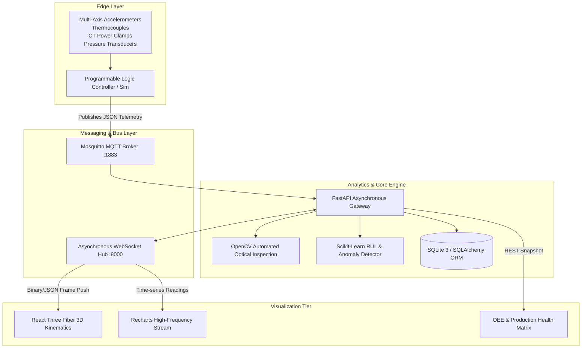
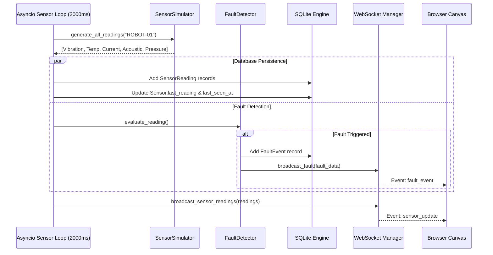
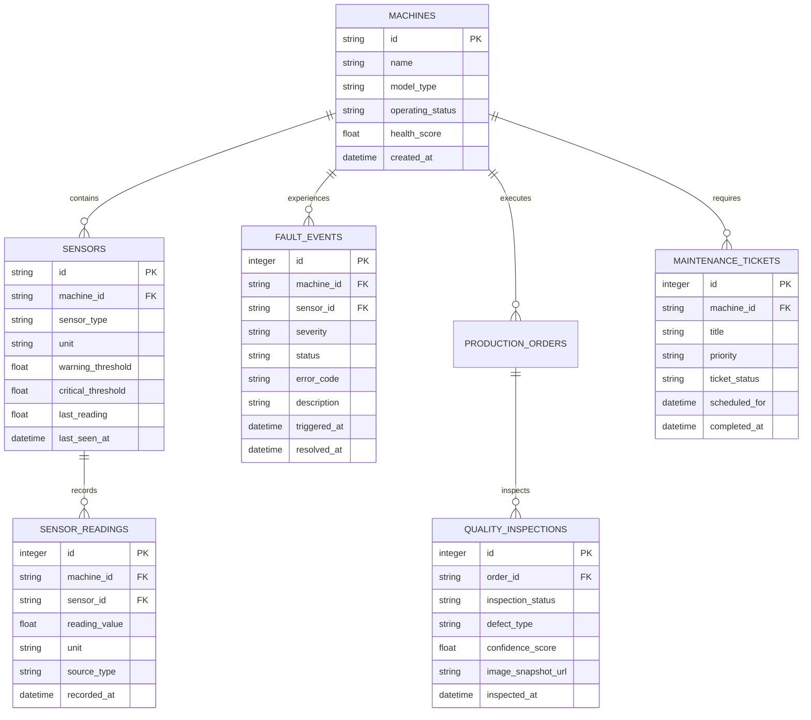

# 🏛️ SmartFactory 4.0 — Technical Architecture & Engineering Specification

> **Confidentiality / Target Audience:** System Architects, Automation Engineers, Machine Learning Researchers, and Embedded/IIoT Developers.  
> **Document Version:** 1.0.0  
> **Target Platform:** Industry 4.0 Cyber-Physical System & Digital Twin

---

## 📑 Table of Contents

1. [Executive Architectural Summary](#1-executive-architectural-summary)
2. [Cyber-Physical System (CPS) Topology](#2-cyber-physical-system-cps-topology)
3. [Component Breakdown & Service Layer](#3-component-breakdown--service-layer)
4. [Mathematical & Algorithmic Formulations](#4-mathematical--algorithmic-formulations)
   - [4.1 Overall Equipment Effectiveness (OEE)](#41-overall-equipment-effectiveness-oee)
   - [4.2 Remaining Useful Life (RUL) Regression](#42-remaining-useful-life-rul-regression)
   - [4.3 Real-Time Anomaly Scoring](#43-real-time-anomaly-scoring)
5. [Kinematics & 3D Digital Twin Coordinate System](#5-kinematics--3d-digital-twin-coordinate-system)
6. [Data Pipeline & Event-Driven Concurrency Model](#6-data-pipeline--event-driven-concurrency-model)
7. [Database Schema & Entity Relationship Model](#7-database-schema--entity-relationship-model)
8. [Communication Protocols & Network Topology](#8-communication-protocols--network-topology)
9. [Chaos Engineering & Simulation Dynamics](#9-chaos-engineering--simulation-dynamics)
10. [Production Hardening & Deployment Topology](#10-production-hardening--deployment-topology)

---

## 1. Executive Architectural Summary

SmartFactory 4.0 is engineered as a **distributed, event-driven cyber-physical production system (CPPS)**. It establishes bidirectional synchronization between physical/simulated industrial machinery and an in-browser WebGL digital twin.



---

## 2. Cyber-Physical System (CPS) Topology

The architecture adheres to the **RAMI 4.0 (Reference Architectural Model Industry 4.0)** standards across three major dimensions:
- **Hierarchy Levels:** Connected Unit $\rightarrow$ Field Device $\rightarrow$ Control Device $\rightarrow$ Station $\rightarrow$ Enterprise.
- **Life Cycle & Value Stream:** Real-time operational feedback loops feeding continuous maintenance schedules.
- **Interoperability Layers:** Integration $\rightarrow$ Communication (MQTT/WebSocket) $\rightarrow$ Information (Pydantic Schema) $\rightarrow$ Functional (FastAPI).

---

## 3. Component Breakdown & Service Layer

### 3.1 Backend Service Decoupling

```
backend/app/
├── core/config.py              # Environment configuration & CORS resolution
├── database.py                 # SQLite connection pooling & thread-safe sessions
├── services/
│   ├── sensor_simulator.py     # Deterministic + Gaussian noise telemetry generator
│   ├── fault_detection.py      # Multi-tiered threshold & gradient validator
│   └── websocket_manager.py    # Ephemeral connection manager & broadcast multiplexer
└── routes/                     # Domain-driven REST controllers
```

- **`sensor_simulator.py`:** Generates high-fidelity multivariate physical signals incorporating nominal operating baselines, ambient thermal drift, and simulated load degradation.
- **`fault_detection.py`:** Evaluates incoming vectors against dynamic tolerance bands and persists `FaultEvent` entries upon anomalous gradient detection.
- **`websocket_manager.py`:** Manages an async set of active client websockets, automatically pruning disconnected clients without blocking the main event loop.

---

## 4. Mathematical & Algorithmic Formulations

### 4.1 Overall Equipment Effectiveness (OEE)

OEE quantifies operational manufacturing excellence by multiplying three independent percentages:

$$\text{OEE} = A \times P \times Q$$

Where:
- **Availability ($A$):**
  $$A = \frac{\text{Operating Time}}{\text{Planned Production Time}} = \frac{T_{\text{planned}} - T_{\text{unplanned\_downtime}}}{T_{\text{planned}}}$$
- **Performance ($P$):**
  $$P = \frac{\text{Ideal Cycle Time} \times \text{Total Count Produced}}{\text{Operating Time}}$$
- **Quality ($Q$):**
  $$Q = \frac{\text{Defect-Free Count}}{\text{Total Count Produced}} = \frac{N_{\text{total}} - N_{\text{defects}}}{N_{\text{total}}}$$

---

### 4.2 Remaining Useful Life (RUL) Regression

Component health and wear modeling follows an exponential hazard and regression formulation based on cumulative stress:

$$H(t) = H_0 \cdot \exp\left(-\lambda \int_0^t \sigma_{\text{eff}}(\tau) \, d\tau\right)$$

Where:
- $H(t) \in [0, 100\%]$ represents the normalized Machine Health Index.
- $\sigma_{\text{eff}}$ is the effective combined mechanical stress computed from vibration RMS ($V_{\text{rms}}$) and bearing temperature ($T_{\text{bearing}}$):
  $$\sigma_{\text{eff}} = \alpha \cdot \left(\frac{V_{\text{rms}}}{V_{\text{nominal}}}\right)^2 + \beta \cdot \left(\frac{T_{\text{bearing}}}{T_{\text{nominal}}}\right)$$
- When $H(t) \le 20\%$, the predictive maintenance engine automatically flags an emergency work order and predicts time to functional failure:
  $$\text{RUL} = \frac{H(t) - H_{\text{critical}}}{\dot{H}_{\text{mean}}}$$

---

### 4.3 Real-Time Anomaly Scoring

Each sensor reading $x_t$ is benchmarked against its running mean $\mu_t$ and variance $\sigma_t^2$ using dynamic Z-Score evaluation:

$$Z(x_t) = \frac{x_t - \mu_t}{\sigma_t}$$

- **Warning Severity:** $|Z(x_t)| \ge 2.5$ or reading breaches absolute warning threshold.
- **Critical Severity:** $|Z(x_t)| \ge 3.8$ or reading breaches hard physical limit.

---

## 5. Kinematics & 3D Digital Twin Coordinate System

The 3D virtual floor is built using **Three.js** and **React Three Fiber**.

```
              Y (Up)
              │
              │
              │
              └──────────── X (Conveyor Flow)
             /
            /
           Z (Depth / Cross-Floor)
```

- **World Origin $(0, 0, 0)$:** Center base of `ROBOT-01` Articulated Arm.
- **Conveyor Belt Axis:** Runs along the $X$-axis from $X = -8.0$ (infeed) to $X = +8.0$ (outfeed).
- **Inspection Chamber:** Positioned at $(X = 3.5, Y = 0.8, Z = 0.0)$, triggering simulated camera flash and optical capture events when parts cross $X \in [3.3, 3.7]$.
- **Kinematic Articulation:**
  - Base Joint ($J_0$): Rotates around the $Y$-axis ($\theta_0 \in [-180^\circ, +180^\circ]$).
  - Shoulder Joint ($J_1$): Tilts along the $Z$-axis ($\theta_1 \in [-45^\circ, +90^\circ]$).
  - Elbow Joint ($J_2$): Articulates along the $Z$-axis ($\theta_2 \in [-60^\circ, +120^\circ]$).
  - Wrist & Tool Flange ($J_3$): Multi-axis orientation for component pickup and sorting.

---

## 6. Data Pipeline & Event-Driven Concurrency Model



The server utilizes Python's non-blocking `asyncio` event loop. Long-lived background tasks run via `asyncio.create_task` during FastAPI application startup, maintaining sub-millisecond dispatch times without locking HTTP request handling.

---

## 7. Database Schema & Entity Relationship Model



---

## 8. Communication Protocols & Network Topology

| Channel | Protocol | Port | Encoding | Primary Purpose |
|:---|:---|:---|:---|:---|
| **REST Gateway** | HTTP/1.1 or HTTP/2 | `8000` | JSON (`application/json`) | CRUD operations, historical queries, analytical summaries, configuration changes |
| **Telemetry Stream** | WebSockets (RFC 6455) | `8000` | JSON / Text frames | Sub-second sensor pushing, machine state transitions, urgent alarms |
| **Edge IIoT Bus** | MQTT v3.1.1 / v5.0 | `1883` | JSON payloads | Ingesting raw sensor strings from physical hardware, PLCs, and microcontrollers |

---

## 9. Chaos Engineering & Simulation Dynamics

The platform provides a native **Chaos Injection Harness** enabling engineers to validate alerting reliability and operator response times without endangering physical assets:

1. **Bearing Failure Mode:** Gradual injection of high-frequency vibrational noise and exponential temperature rises to verify RUL re-estimation.
2. **Thermal Runaway Mode:** Simulates cooling fan failure or ambient insulation breakdown, testing emergency stop sequences.
3. **Brownout / Voltage Surge Mode:** Fluctuates simulated electrical bus voltage between 180V and 260V to audit power protection trips.
4. **Optical Quality Degradation:** Increases defect probability from default 15% to 80% to test downstream quarantine diverters.

---

## 10. Production Hardening & Deployment Topology

For multi-node industrial deployments:
- **Database:** Migrate from SQLite to **PostgreSQL with TimescaleDB extension** for multi-terabyte time-series sensor archiving.
- **Message Broker:** High-availability cluster using **RabbitMQ** or **EMQX** with TLS encryption (`mqtts://:8883`).
- **Containerization:** Pre-configured Docker Compose files separating Frontend, Backend, Mosquitto, and Reverse Proxy (Nginx / Traefik).
- **Authentication:** OAuth2 with JWT bearer tokens for role-based access control (Operator, Reliability Engineer, Plant Administrator).

---

<div align="center">
<b>SmartFactory 4.0 Architecture Specification</b> • Designed for Resilience, Speed, and Operational Intelligence
</div>
